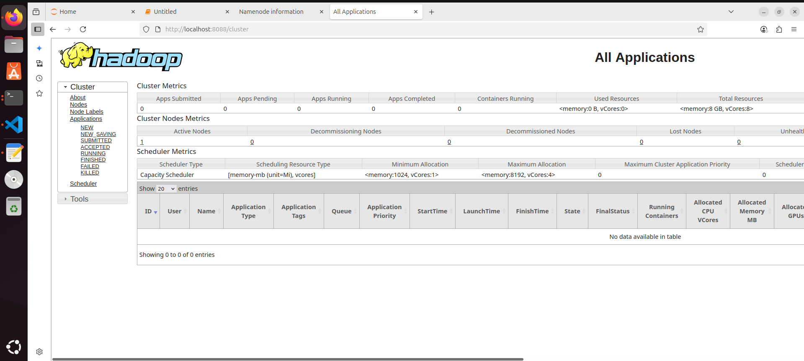
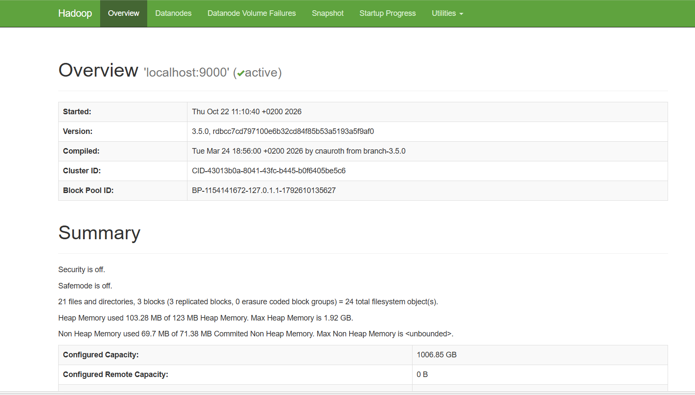

# Data Warehouse Implementation

In this practical we setup a data warehouse using Apache Hive, Apache Hadoop, Apache Spark. Notably, we replace the Mapreduce component of Apache Hadoop with Spark because Spark is designed for in-memory processing, making it faster than Mapreduce. Additionally, we use Python for interacting with Spark (through PySpark) and that is an added advantage of Spark since Mapreduce requires Java code for each task.

We leverage the Medallion architecture for building data pipelines which extracts data from various source systems, transforms the data, and loads it into the warehouse. That is, an ETL pipeline is used instead of an ELT pipelines (i.e., in the warehouse we only load clean, aggregated business data to support decision making).

_**Authors: Brian Msane and Bandile Malaza**_\
_**Reviewer: Prof. Stephen Fashoto**_

## Getting Started 💻

For getting started with this practical we need a few things which include:

| Component        | Version      |
|------------------|--------------|
| OS               | Ubuntu 26.04 |
| Java             | 21           |
| Hadoop           | 3.5.0        |
| Spark            | 4.2.0        |
| Hive             | 4.2.1        |
| Python           | 3.14         |
| PySpark          | Latest       |
| Jupyter Notebook | Latest       |

If you're on Windows, make sure you enable `WSL` and you can install Ubuntu as follows.

- Open `PowerShell` as an **Administrator** and run this command.

```powershell
wsl --install
```

If the distribution is not installed by default, run this command to install it. This installs a specific distribution but you can change the version to another one.

```powershell
wsl.exe --install Ubuntu-26.04
```

_Restart your PC, if prompted,_  and ensure **virtualization** is enabled in **BIOS**. _([Refer to this guide](https://support.microsoft.com/en-us/windows/experience/enable-virtualization-on-windows))_

_Alternatively;_ If you are going to be using a virtual machine (VM), powered by Ubuntu operating system,[Ubuntu 26.04 LTS image](https://www.virtualbox.org/wiki/Downloads), you need to follow the [VM guide](./virtual-machines.md). Once the VM is up an running we can then proceed with the steps below. To install Virtualbox and install Ubuntu in your Windows machine, follow this [guide](https://dev.to/florianfelsing/how-to-run-an-ubuntu-vm-on-windows-11-4oef).

## Create `data` User

Setup the default Unix user credentials; username and password. Open the Ubuntu terminal and create a user called `data`. You will be prompted to provide and confirm a _password_. Note: save this password as it is going to be needed multiple times later on.

```bash
sudo adduser data
```

Elevate user privileges and add `data` to the `sudo` group.

```bash
sudo usermod -aG sudo data
```

Switch to the `data` user. Once you have successfully created the user, you need to switch to that user using the command below. It will prompt you to provide the password you created above.

```bash
su - data
```

## Clone Repo ✨

Clone this repository to ensure that you have the _shell scripts_ needed for the installation process. Run the commands below; they will install `git`, configure your `git` global username and email and then clone this repository into your PC, in the `$HOME` directory. You will be required to provide your password for the `data` user. _Note: many distributions already come with `git` pre-installed but the command is meant to be safe and install it in case it is not already installed_. Replace **Username** and **Email** with your actual GitHub username and email in the second command.

```bash
sudo apt update && sudo apt install dos2unix && sudo apt install git -y
```

```bash
git config --global user.name "Username" ; git config --global user.email "email@example.com"
```

```bash
cd $HOME && git clone https://github.com/BrianMsane/PySpark-Practical.git
```

For ease of the installion process, you should export the path to the shell scripts to be executed. _This makes the environment variable only available in the current terminal session so ensure that you keep this terminal session active and run subsequent commands here_. NoteL you might required to run this multiple times.

```bash
export SCRIPTS_HOME="$HOME/PySpark-Practical/scripts"
```

Once you have cloned to repository you need to ensure that the shell files are Unix-executable by running this command.

```bash
dos2unix $SCRIPTS_HOME/ensure-executable.sh && chmod +x $SCRIPTS_HOME/ensure-executable.sh && bash $SCRIPTS_HOME/ensure-executable.sh
```

## Install Java

Most of the sotfware we're using require `Java` to be installed in your system. So, for installing Java, the bash script `java-install.sh` has all the needed commands.

```bash
bash $SCRIPTS_HOME/java-install.sh
```

## Setup SSH

Hadoop requires passwordless SSH for communication between nodes, so configure that using the sript below.

```bash
bash $SCRIPTS_HOME/ssh-setup.sh
```

If you have not configured the password, all you have to do is type `'yes'` and hit `Enter` key twice.

## Download Hadoop

We are going to use the `/opt` folder for storing the required modules and frameworks.

```bash
sudo mkdir -p /opt && sudo chown $USER /opt && cd /opt
```

The script `hadoop-setup.sh` will download Hadoop into your system and perform necessary steps and then place it in the right location. Please do expect it to take time (depending on your Internet connection) as Hadoop files can be massive.

```bash
bash $SCRIPTS_HOME/hadoop-setup.sh
```

## Configure Environment Variables

We need to configure some environment variables to ensure smooth operation of `Java`, `Spark`, `Hive`, and `Hadoop`. To do that, we need open the `.bashrc` file and navigate to the last line and then export some environment variables and the command below will do just that.

```bash
bash $SCRIPTS_HOME/env-variables.sh && source "$HOME/.bashrc"
```

## Hadoop Files

Export `JAVA_HOME` in the `hadoop-env.sh` file.

```bash
bash $SCRIPTS_HOME/edit-hadoop-env.sh
```

Create the two mandatory data files for Hadoop information to be kept in. These files are critical for Hadoop Distributed File System (HDFS). We put them in the `/data` folder in `$HADOOP_HOME`.

```bash
mkdir -p $HADOOP_HOME/data/namenode $HADOOP_HOME/data/datanode
```

## Hadoop Configurations

Also, We need to edit a couple of Hadoop file to add **configurations**. For each of the file listed below, we delete the current file and copy the one in the /conf directory in this repository. The latter contains the configurations while the former is just a template you configure on top of. This approach eliminates manual work.

- core-site.xml
- hdfs-site.xml
- mapred-site.xml
- yarn-site.xml

```bash
bash $SCRIPTS_HOME/hadoop-conf.sh
```

Now the files are in order 🥂! Now we initialize metadata storage.

```bash
hdfs namenode -format
```

Initialize all Hadoop daemons.

```bash
start-all.sh
```

To verify whether the Java processes are running, run `jps`. The processes `NameNode`, `NodeManager`, `DataNode`, `SecondaryNameNode`, and `ResourceManager` should be running.

Also, you can access these two addresses `http://localhost:9870` and `http://localhost:8088` in your brower. The latter is for **YARN** while the former one is for **HDFS**. You should have an output similar to the one on the image below on one of the links.




## Installing Spark

To install Spark, we need to download and move Spark to the ideal directory which is `/opt/spark` and the shell script below does just that for you, so simply run it. Note: we have already exported the `$SPARK_HOME` environment variable in the `bashrc` file. To confirm if `Spark` has been successfully setup, run this `spark --version`

```bash
bash $SCRIPTS_HOME/spark-setup.sh
```

To confirm if `Spark` has been successfully setup, run this `spark --version`

## Setting up Pip and Virtual Environment

Since `Ubuntu 26.04` comes with `Python 3.14` pre-installed, we have to install `pip3` for managing packages. Also, we have to create a **virtual environment** and install the dependencies like `pyspark` and `jupyter notebook`.

```bash
bash $SCRIPTS_HOME/python-setup.sh
```

After creating and activating the virtual environment, the scripts will open Juypter Notebook. What you have to do is open your broswer and paste this URL `http://localhost:8888/` in the address bar and then create a **New notebook file**

## Sample Code 🧑‍💻

Insert a cell, paste, and run the code below:

```python
from pyspark.sql import SparkSession


spark = SparkSession.builder \
    .appName("simpleapp") \
    .master("local[*]") \
    .getOrCreate()

data = [
  ("Metfula", 25, "Eswatini"),
  ("Elliot", 28, "Zimbabwe"),
  ("Aina", 30, "Namibia")
]
df = spark.createDataFrame(data, ["Name", "Age", "Country"])
df.show()
```

The expected output is

```python
+-------+---+---------+
|   Name|Age|  Country|
+-------+---+---------+
|Metfula| 25| Eswatini|
| Elliot| 28| Zimbabwe|
|Fashoto| 30|  Nigeria|
+-------+---+---------+
```

**Congrats** 🎉🎉🎉, now you are ready for the practical 👨‍💻👩‍💻!
